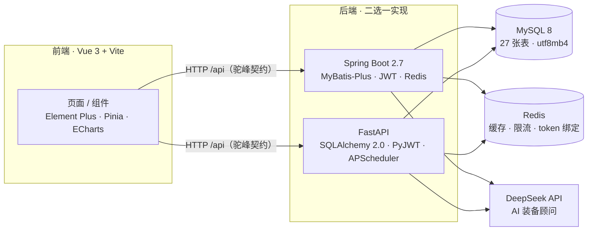

# 乒乓球装备推荐系统

**PingPong Equipment Recommendation System**

[](https://github.com/zhehuang907/pingpong-system/actions/workflows/ci.yml)
[](./LICENSE)


> 面向乒乓球爱好者的个性化装备推荐系统：以「三路召回 + 多因子打分」为推荐内核，
> 覆盖装备浏览、对比、收藏、购物车、评论、浏览历史、榜单活动与 AI 装备顾问的完整业务闭环。
>
> A personalized table-tennis equipment recommendation system. It ships a
> three-way-recall ranking engine plus a complete product workflow: browsing,
> comparison, favorites, cart, comments, browsing history, leaderboards and an
> AI equipment advisor.

## 目录

- [1. 项目简介](#1-项目简介)
- [2. 技术架构](#2-技术架构)
- [3. 核心功能](#3-核心功能)
- [4. 推荐算法](#4-推荐算法)
- [5. 目录结构](#5-目录结构)
- [6. 快速开始](#6-快速开始)
- [7. 环境变量](#7-环境变量)
- [8. 测试](#8-测试)
- [9. 两套后端的关系](#9-两套后端的关系)
- [10. 接口一览](#10-接口一览)
- [11. 已知限制](#11-已知限制)
- [12. 开源协议](#12-开源协议)

---

## 1. 项目简介

本项目面向乒乓球爱好者，解决"器材参数复杂、选型依赖经验"的问题：用户填写水平、
打法、发力习惯与特殊需求后，系统结合其浏览 / 收藏 / 评论 / 购买行为，输出个性化推荐、
相似装备推荐与热度榜单，并提供 AI 装备顾问进行自然语言问答。

| 维度 | 说明 |
| --- | --- |
| 后端（Java） | Spring Boot 2.7.18 + MyBatis-Plus + JWT + Redis，147 个 Java 类 / 15 个 Controller |
| 后端（Python） | FastAPI + SQLAlchemy 2.0 + PyJWT + APScheduler，接口契约与 Java 侧逐字段对齐 |
| 前端 | Vue 3.3 + Vite 4 + Element Plus + Pinia + ECharts，32 个 `.vue` 页面/组件 |
| 数据库 | MySQL 8 / InnoDB / `utf8mb4`，27 张表，22 个按日期命名的迁移脚本 |
| 测试 | Java 22 个测试类（JUnit + MockMvc）、Python 33 个 pytest 用例（SQLite 内存库） |

## 2. 技术架构



两套后端共用同一份库表、同一套 JWT 密钥与完全一致的响应契约，因此可以**直接互切**，
无需数据迁移。详见 [第 9 节](#9-两套后端的关系)。

## 3. 核心功能

- **账号体系**：注册 / 登录 / 登出、JWT 鉴权、BCrypt 密码哈希、登录审计、限流。
- **装备业务**：分类与标签体系、装备列表（多条件筛选 + 价格区间）、装备详情、
  装备对比、装备图片上传。
- **个性化推荐**：基于用户画像与行为的个性化推荐、装备详情页相似推荐、
  热门榜单、推荐结果记录与曝光埋点。
- **互动闭环**：收藏、购物车（勾选 / 全选 / 结算）、评论（含回复与点赞）、
  浏览历史、用户偏好画像。
- **榜单与活动**：多榜单中心、榜单快照与订阅、分享统计、开球王活动（赛季 / 阶段 / 积分榜）。
- **AI 装备顾问**：接入 DeepSeek，结合装备目录上下文回答选型问题；未配置密钥时自动降级为兜底文案。
- **管理后台**：数据看板、用户管理、装备 / 分类 / 标签管理、评论审核、Excel 导出。

## 4. 推荐算法

推荐内核为「三路召回 + 多因子打分」，所有权重均可在配置中调整，无需改代码。

| 环节 | 策略 |
| --- | --- |
| 行为权重 | 浏览 1 / 收藏 3 / 评论 5 / 购买 10 |
| 兴趣锚点 | 取权重最高的若干条交互装备作为兴趣锚点（默认 20 条） |
| 候选池 | 上限 300 条，控制打分开销 |
| 相似度 | 标签 Jaccard × 0.6 + 同类目 × 0.3 + 价格接近度 × 0.1，低于阈值 0.3 不入选 |
| 榜单热度 | `热度 = 收藏×0.3 + 评论×0.2 + 评分×0.5 + 时间衰减 + log1p(浏览量)×0.55`，衰减 = `exp(-小时/240) × 1.8` |

对应实现：Java `RecommendServiceImpl`、Python `app/services/recommend.py` 与 `app/services/leaderboard.py`。

## 5. 目录结构

```
pingpong-recommendation-system/
├── backend/                 # Spring Boot 后端（Java 8）
│   ├── src/main/java/com/pingpong/
│   │   ├── controller/      # 15 个 REST 接口
│   │   ├── service/impl/    # 业务逻辑（含推荐、榜单、AI 顾问）
│   │   ├── mapper/  entity/ # MyBatis-Plus 映射与实体
│   │   ├── config/  common/ # 配置、统一响应、异常处理
│   │   ├── interceptor/     # JWT 鉴权与限流拦截器
│   │   ├── realtime/        # WebSocket 实时推送
│   │   └── scheduler/       # 榜单定时重算
│   ├── src/test/java/com/pingpong/   # 22 个测试类
│   ├── pom.xml
│   └── mvnw / mvnw.cmd      # Maven 启动脚本（优先使用内置 Maven，否则回退系统 mvn）
│
├── backend-py/              # FastAPI 后端（Python 3.13，与 Java 侧契约一致）
│   ├── app/
│   │   ├── api/routes/      # 路由层（对应 *Controller）
│   │   ├── services/        # 业务逻辑
│   │   ├── models/          # 27 张表的 SQLAlchemy ORM 模型
│   │   ├── schemas/         # Pydantic 模型（驼峰别名）
│   │   ├── middleware/      # JWT 鉴权 / 限流
│   │   ├── core/            # 配置、统一响应、安全、Redis 降级客户端
│   │   └── scheduler/       # APScheduler 定时任务
│   ├── tests/               # 33 个 pytest 用例
│   ├── requirements.txt
│   └── .env.example
│
├── frontend/                # Vue 3 + Vite 前端
│   ├── src/api/             # 按业务域拆分的接口封装
│   ├── src/views/           # 32 个页面（含 admin/ 管理端）
│   ├── src/components/      # 公共组件
│   ├── src/store/ router/ utils/
│   └── vite.config.js
│
├── database/
│   ├── schema.sql           # 完整结构（27 张表）+ 非个人演示数据
│   ├── migration.sql        # 基础迁移脚本
│   ├── migrations/          # 23 个按日期排序的历史变更脚本
│   └── scripts/             # 管理员账号等一次性运维脚本（哈希改为占位符）
│
├── .github/                 # CI、Issue / PR 模板
├── CONTRIBUTING.md
├── LICENSE
└── README.md
```

## 6. 快速开始

### 6.1 环境要求

| 组件 | 版本 |
| --- | --- |
| JDK | 8+（`pom.xml` 声明 `java.version=1.8`） |
| Maven | 3.6+（`backend/mvnw.cmd` 会优先使用内置 Maven，不存在时回退系统 `mvn`） |
| Node.js | 18+ |
| Python | 3.10+（开发环境使用 3.13） |
| MySQL | 8.0+ |
| Redis | 6+（可选：连不上时后端自动降级为无缓存 / 不限流） |

### 6.2 初始化数据库

```bash
# 创建库（utf8mb4）
mysql -u root -p -e "CREATE DATABASE pingpong_recommendation DEFAULT CHARACTER SET utf8mb4;"

# 导入完整结构与演示数据
mysql -u root -p pingpong_recommendation < database/schema.sql
```

### 6.3 启动后端（二选一）

**A. Java / Spring Boot**

```bash
cd backend
# Windows
.\mvnw.cmd spring-boot:run
# macOS / Linux
./mvnw spring-boot:run
```

**B. Python / FastAPI**

```bash
cd backend-py
python -m venv .venv
# Windows: .venv\Scripts\activate   |  macOS/Linux: source .venv/bin/activate
pip install -r requirements.txt
cp .env.example .env          # 按需修改 DB_* / JWT_SECRET
python -m app.main
```

两者默认地址均为 `http://localhost:8081/api`；Python 侧额外提供接口文档
`http://localhost:8081/api/docs`。

### 6.4 启动前端

```bash
cd frontend
npm install
npm run dev
```

前端开发服务器默认 `http://127.0.0.1:3000`，通过 `vite.config.js` 的 proxy 将 `/api`
转发到 `http://localhost:8081`。

> 生产部署时执行 `npm run build`，将 `frontend/dist/` 的产物拷贝到
> `backend/src/main/resources/static/`，即可由后端统一托管前端静态资源。
> 该目录属构建产物，已在 `.gitignore` 中排除。

## 7. 环境变量

`backend/src/main/resources/application.yml` 与 `backend-py/app/core/config.py` 均支持
用环境变量覆盖默认值；**仓库中不含任何真实凭据**。

| 变量 | 默认值 | 说明 |
| --- | --- | --- |
| `DB_HOST` / `DB_PORT` | `127.0.0.1` / `3306` | MySQL 地址 |
| `DB_USER` / `DB_PASSWORD` | `root` / 空 | MySQL 账号；本地开发请自行填入 |
| `DB_NAME` | `pingpong_recommendation` | 库名 |
| `REDIS_HOST` / `REDIS_PORT` | `localhost` / `6379` | Redis 地址 |
| `REDIS_ENABLED` | `true` | 置为 `false` 可完全跳过 Redis |
| `JWT_SECRET` | `dev-only-secret-change-me` | **两套后端必须填同一值**，生产环境务必改为强随机串 |
| `UPLOAD_PATH` | `./uploads/` | 图片上传目录（相对后端工作目录） |
| `DEEPSEEK_API_KEY` | 空 | 留空时 AI 顾问返回兜底文案而非报错 |
| `DEEPSEEK_ENABLED` / `DEEPSEEK_MODEL` | `true` / `deepseek-chat` | AI 顾问开关与模型 |
| `SCHEDULER_ENABLED` | `false` | 榜单定时任务开关（Python 侧） |

## 8. 测试

```bash
# Java：JUnit + MockMvc，需要可用的 MySQL（或对应测试配置）
cd backend && .\mvnw.cmd test

# Python：SQLite 内存库，无需 MySQL / Redis
cd backend-py && python -m pytest

# 前端：生产构建校验
cd frontend && npm run build
```

## 9. 两套后端的关系

`backend/` 与 `backend-py/` 是同一个后端契约的两种实现，刻意保持以下一致：

| 关注点 | 一致性设计 |
| --- | --- |
| 接口路径 | 与前端 `src/api/*.js` 逐路径对齐，前端零改动 |
| 响应结构 | 统一 `{code, msg, data}`；业务错误沿用 HTTP 200 + `code != 200` 语义 |
| 字段命名 | 一律驼峰（Java 用 Jackson，Python 用 `alias_generator=to_camel`） |
| 密码哈希 | Hutool BCrypt 与 Python `bcrypt` 互通，无需重置密码 |
| 鉴权 | 同一 `JWT_SECRET` + HS512，token 可跨语言互认 |
| Redis | 缺失时降级为「无缓存 / 不绑定 / 不限流」而非启动失败 |

> 若同时启动两套后端，请只在一侧开启榜单定时任务，避免重复计算。

## 10. 接口一览

后端统一前缀 `/api`，主要资源分组如下（完整定义见前端 `frontend/src/api/`）：

| 分组 | 路径前缀 | 说明 |
| --- | --- | --- |
| 鉴权 | `/auth`、`/user` | 注册、登录、验证码、资料与密码修改 |
| 装备 | `/equipment`、`/category`、`/tag` | 列表筛选、详情、对比、管理端增删改 |
| 推荐 | `/recommend`、`/recommendation` | 个性化推荐、相似推荐、推荐工作台 |
| 互动 | `/favorite`、`/cart`、`/comment`、`/history` | 收藏、购物车、评论与回复、浏览历史 |
| 榜单 | `/leaderboard`、`/kaiqiuwang-ranking` | 榜单中心、快照、订阅、分享统计 |
| 活动 | `/kickoff-king` | 开球王赛季、阶段与积分榜 |
| AI | `/ai/chat` | DeepSeek 装备顾问（会话与消息落库） |
| 上传 | `/upload` | 装备图片上传（后缀与体积校验） |
| 管理 | `/admin` | 数据看板、用户 / 装备 / 分类 / 标签 / 评论管理、Excel 导出 |

## 11. 已知限制

- `database/schema.sql` 含 8 张非个人演示表的数据；用户、评论、浏览行为、登录审计等
  隐私数据**不在仓库内**，需自行产生。
- 装备图片上传目录 `backend/uploads/` 属运行期数据，已从版本库排除，
  克隆后需重新上传或使用前端占位图。
- `frontend/src/assets/champions/` 中的运动员照片仅用于课程演示，版权归原权利人；
  如需公开商用请自行替换为自有素材。
- 前端生产构建存在单包体积告警，后续可通过路由级代码分割优化。

## 12. 开源协议

本项目基于 [MIT License](./LICENSE) 发布。
